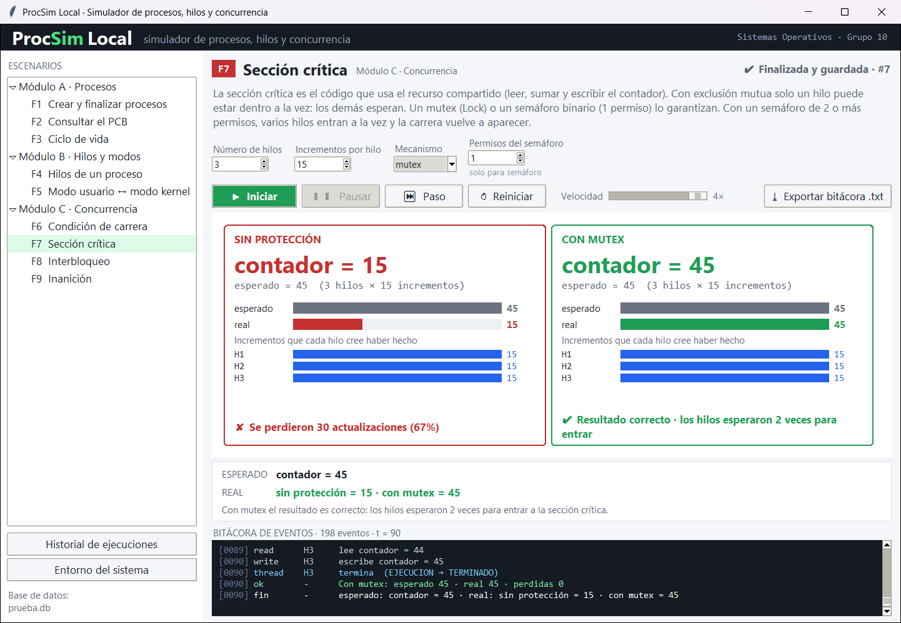
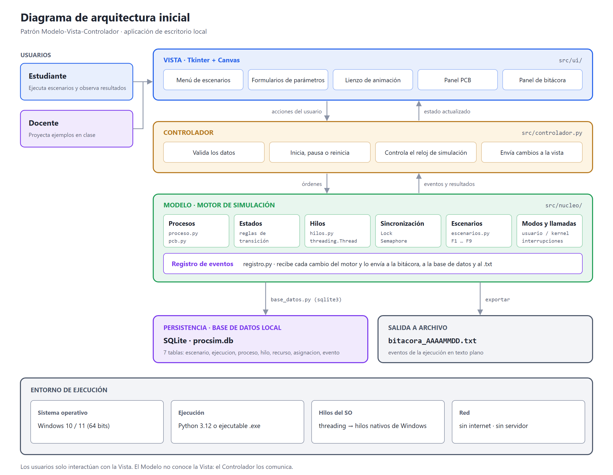
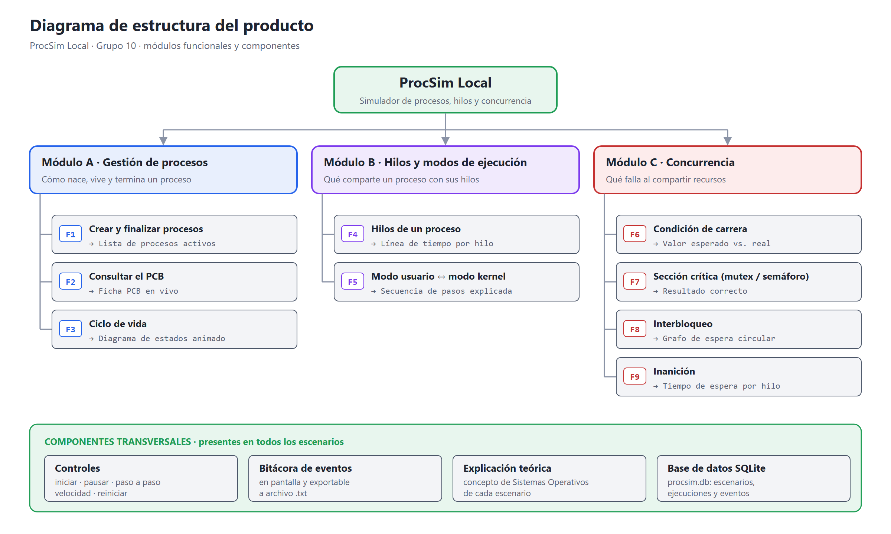
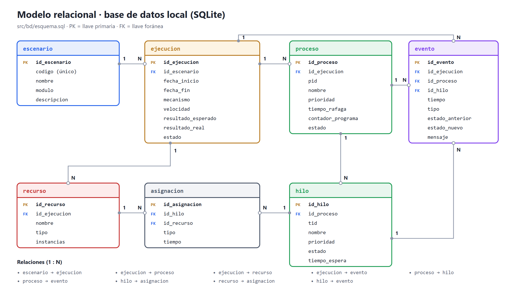
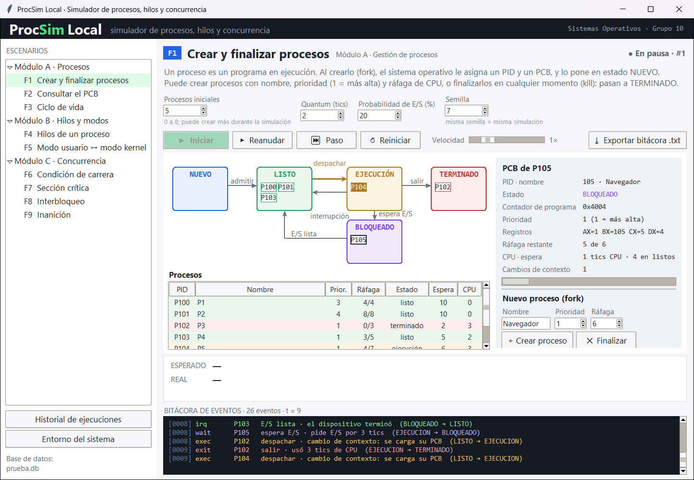
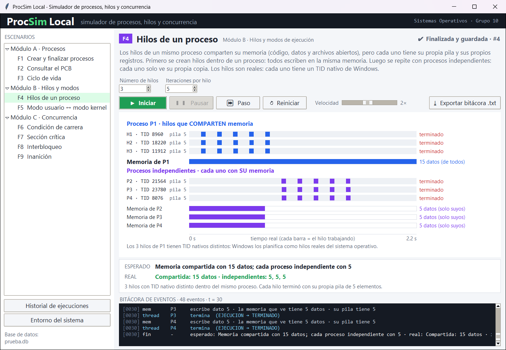
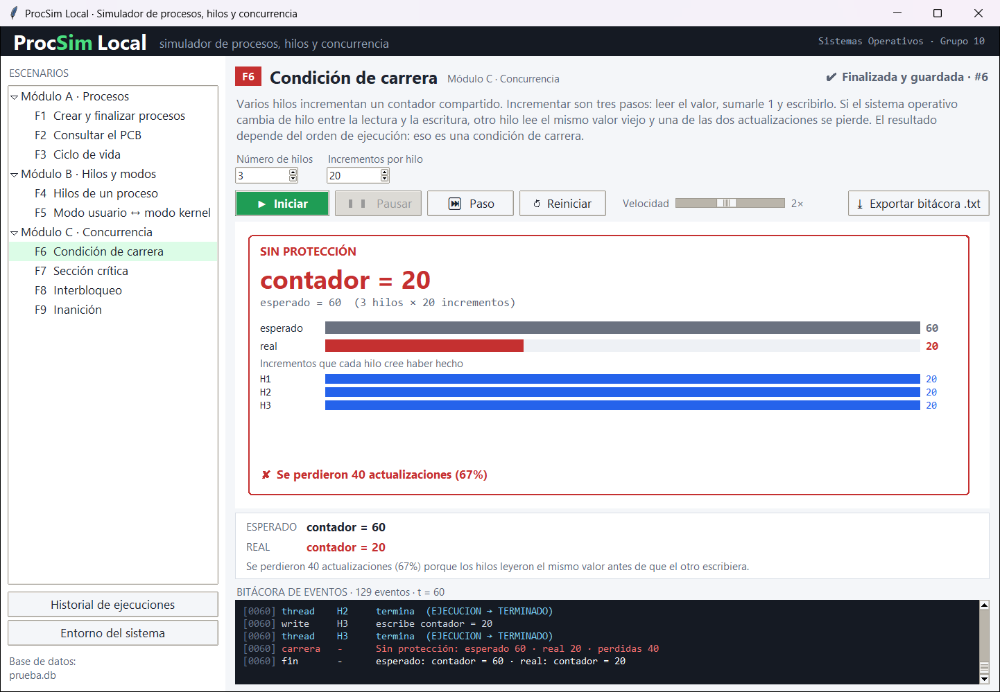
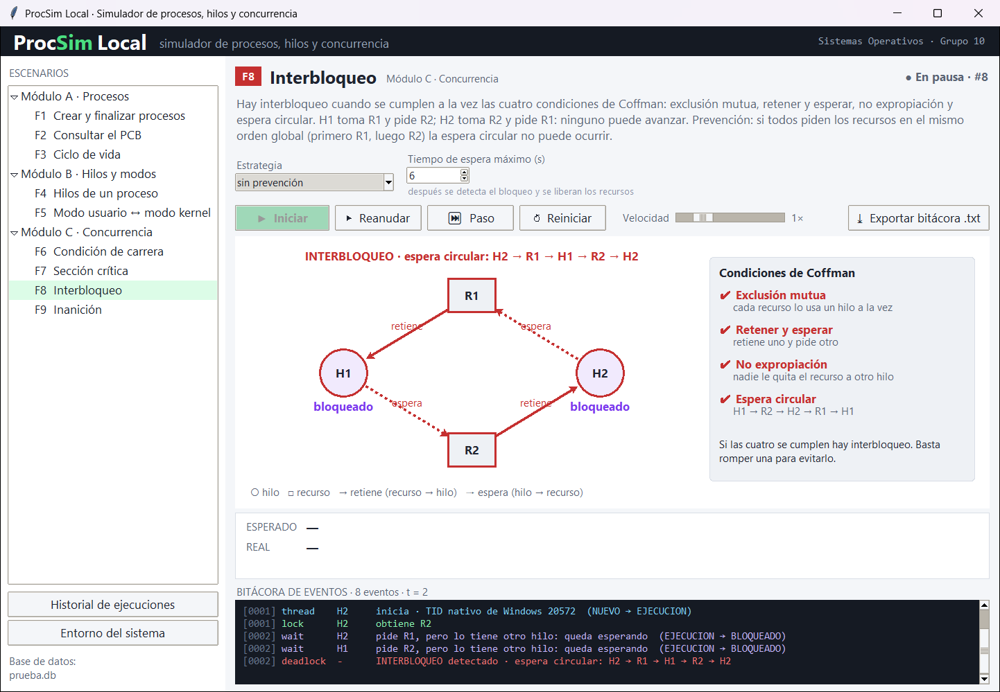
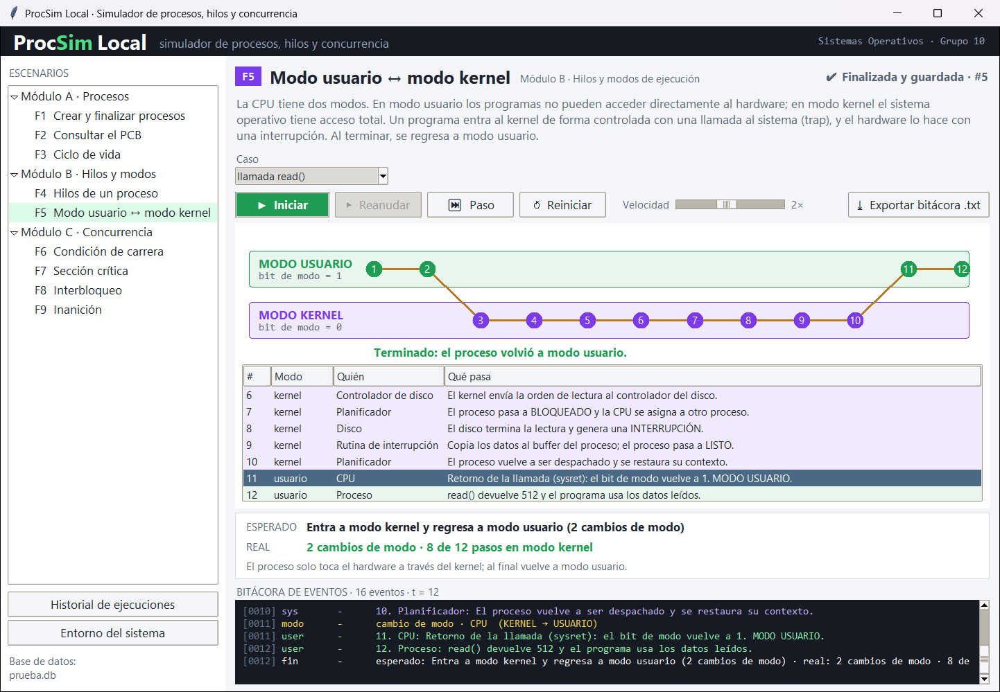
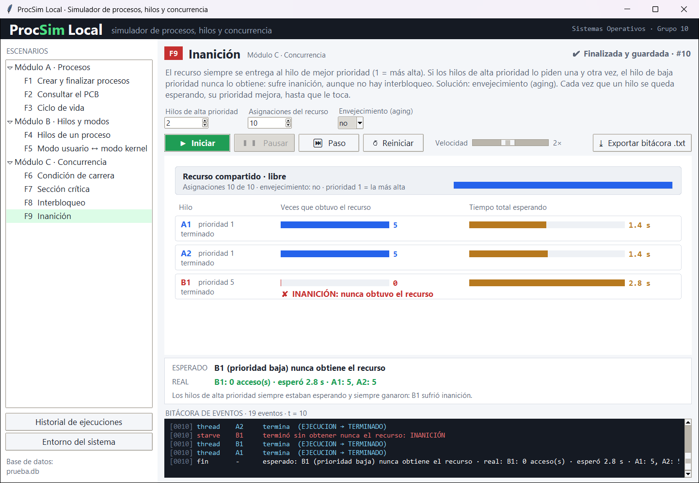

# ProcSim Local

**Simulador de escritorio de procesos, hilos y concurrencia para Windows.**

| Asignatura | Grupo | Programa | Universidad | Periodo |
|---|---|---|---|---|
| Sistemas Operativos | 10 | Ingeniería de Software | Universidad Manuela Beltrán | 2026 |

> **Estado:** Fase II completada · prototipo funcional con las 9 funciones, base de datos SQLite y 42 pruebas automáticas. Ver [avance de la Fase II](documentacion/fase2_avance.md).



---

## Tabla de contenido

1. [Descripción general](#1-descripción-general)
2. [Problemática que aborda](#2-problemática-que-aborda)
3. [Objetivos](#3-objetivos)
4. [Alcance](#4-alcance)
5. [Funcionalidades principales](#5-funcionalidades-principales)
6. [Relación con Sistemas Operativos](#6-relación-con-sistemas-operativos)
7. [Arquitectura y estructura general](#7-arquitectura-y-estructura-general)
8. [Tecnologías](#8-tecnologías)
9. [Requisitos iniciales de ejecución](#9-requisitos-iniciales-de-ejecución)
10. [Documentación técnica](#10-documentación-técnica)
11. [Integrantes del equipo](#11-integrantes-del-equipo)
12. [Estado actual y próximos avances](#12-estado-actual-y-próximos-avances)

---

## 1. Descripción general

ProcSim Local es una aplicación de escritorio para Windows que muestra de forma visual e interactiva lo que hace un sistema operativo cuando **crea y administra procesos e hilos**. También muestra cómo aparecen y se controlan los problemas de concurrencia: **condición de carrera, interbloqueo e inanición**.

El usuario elige un escenario, configura sus parámetros y la aplicación lo ejecuta paso a paso. En pantalla se ven el diagrama de estados, el PCB de cada proceso, la línea de tiempo de los hilos y una bitácora de eventos. Cada ejecución se guarda en una base de datos local SQLite.

Los procesos son **simulados**, pero los escenarios de concurrencia usan **hilos reales** de Python, que Windows planifica como hilos nativos: los errores que se ven en pantalla ocurren de verdad.

## 2. Problemática que aborda

### Problemática

En Sistemas Operativos, los temas de procesos, hilos y concurrencia se estudian sobre todo en teoría (diapositivas, diagramas estáticos y ejercicios en papel):

- **Conceptos abstractos.** Los estados de un proceso, el PCB o el cambio entre modo usuario y modo kernel ocurren dentro del sistema operativo y no se pueden ver.
- **Concurrencia difícil de observar.** La condición de carrera, el interbloqueo y la inanición dependen del orden en que corren los hilos, y en un programa real no siempre se repiten.
- **Poca práctica.** Las herramientas reales (administrador de tareas, depuradores, consola) son complejas y no están pensadas para enseñar; otras requieren Linux o máquinas virtuales.
- **Difícil de demostrar en clase.** El docente no tiene una herramienta sencilla para proyectar un ejemplo, pausarlo y repetirlo.

### Necesidad

Una **herramienta sencilla, local y visual** para Windows, sin internet ni instalaciones complejas, que permita ver cómo se gestionan procesos e hilos, reproducir los problemas de concurrencia, comparar el resultado sin protección contra el resultado con mutex o semáforo, controlar la simulación paso a paso y guardar el historial.

### Usuarios

| Usuario | Uso |
|---|---|
| Estudiante | Ejecuta escenarios, cambia parámetros y observa los resultados. |
| Docente | Proyecta ejemplos en clase, los pausa y los repite paso a paso. |

## 3. Objetivos

### Objetivo general

Desarrollar una aplicación de escritorio para Windows que simule, de forma visual e interactiva, cómo un sistema operativo crea y administra procesos e hilos, y cómo aparecen y se controlan la condición de carrera, el interbloqueo y la inanición.

### Objetivos específicos

1. Implementar un módulo de **gestión de procesos**: crear y finalizar procesos, consultar el PCB y animar el ciclo de vida.
2. Implementar un módulo de **hilos y modos de ejecución**: comparar hilos con procesos y mostrar el paso de modo usuario a modo kernel.
3. Implementar un módulo de **concurrencia** con hilos reales: condición de carrera, sección crítica, interbloqueo e inanición.
4. Diseñar una **interfaz gráfica** con controles de simulación y explicación teórica en cada escenario.
5. Registrar cada evento en una **base de datos local SQLite** y exportar la bitácora a `.txt`.
6. Validar el funcionamiento con **casos de prueba** y documentar el proyecto en GitHub.

## 4. Alcance

| ✅ Incluye | ❌ No incluye |
|---|---|
| Prototipo funcional de escritorio para Windows 10/11. | Crear o modificar un kernel real: los procesos son simulados. |
| Las 9 funciones descritas abajo. | Gestión de memoria, sistema de archivos ni planificación avanzada. |
| Hilos reales de Python en los escenarios de concurrencia. | Versiones web, móvil, Linux o macOS. |
| Base de datos local SQLite (escenarios, ejecuciones y bitácora). | Inicio de sesión, base de datos en servidor o modo multiusuario. |
| Repositorio en GitHub, README y manual de usuario. | Control de los procesos reales del equipo. |
| Casos de prueba con capturas y análisis de resultados. | |

## 5. Funcionalidades principales

**9 funciones en 3 módulos.** En cada una, el usuario configura un escenario y la aplicación lo ejecuta y lo muestra en pantalla.

| Módulo | # | Función | Resultado en pantalla |
|---|---|---|---|
| **A · Gestión de procesos** | F1 | Crear y finalizar procesos (nombre, prioridad, ráfaga) | Lista de procesos activos |
| | F2 | Consultar el PCB (PID, estado, contador de programa, prioridad, registros) | Ficha PCB en vivo |
| | F3 | Ciclo de vida (nuevo, listo, ejecución, bloqueado, terminado) | Diagrama de estados animado |
| **B · Hilos y modos** | F4 | Hilos de un proceso frente a procesos independientes | Línea de tiempo por hilo |
| | F5 | Modo usuario ↔ modo kernel (`read()` e interrupción de E/S) | Secuencia de pasos explicada |
| **C · Concurrencia** | F6 | Condición de carrera: dos hilos y un contador sin protección | Valor esperado vs. real |
| | F7 | Sección crítica con mutex o semáforo | Resultado correcto y comparación |
| | F8 | Interbloqueo: dos hilos esperan el recurso del otro | Grafo de espera circular |
| | F9 | Inanición: un hilo de baja prioridad nunca obtiene el recurso | Tiempo de espera por hilo |

**En todos los escenarios:** controles (iniciar, pausar, paso a paso, velocidad, reiniciar), bitácora de eventos exportable a `.txt` y explicación breve del concepto teórico.

## 6. Relación con Sistemas Operativos

| Concepto | Función |
|---|---|
| Proceso y ciclo de vida | F1, F3 |
| Bloque de control de proceso (PCB) | F2 |
| Planificación y cambio de contexto | F3 |
| Hilos: memoria compartida, pila y registros propios | F4 |
| Modo usuario / kernel, llamadas al sistema e interrupciones | F5 |
| Condición de carrera | F6 |
| Sección crítica, exclusión mutua, mutex y semáforos | F7 |
| Interbloqueo (condiciones de Coffman, grafo de asignación de recursos) | F8 |
| Inanición y prioridades | F9 |

## 7. Arquitectura y estructura general

La aplicación sigue el patrón **Modelo-Vista-Controlador (MVC)**:

- **Vista** (`src/ui/`): Tkinter + Canvas. Menú de escenarios, formularios, lienzo de animación, panel PCB y bitácora.
- **Controlador** (`src/controlador.py`): valida los datos, inicia, pausa o reinicia, controla el reloj de simulación y actualiza la vista.
- **Modelo** (`src/nucleo/`): motor de simulación con procesos, PCB, hilos, sincronización, escenarios y registro de eventos.
- **Persistencia** (`src/bd/`): base de datos SQLite local (`procsim.db`).



### Estructura del producto



### Modelo relacional



### Organización del repositorio

```
ProcSimLocal_SistemasOperativos_G10/
├── README.md                  # este documento
├── LICENSE                    # licencia MIT
├── documentacion/             # documentación técnica (.md y .pdf)
│   ├── fase2_avance.md        # avance de la Fase II
│   ├── evidencias/            # entorno, pruebas, bitácoras y consulta a la BD
│   └── diagramas/             # diagramas (.svg y .png)
├── src/                       # código fuente
│   ├── main.py                # punto de entrada
│   ├── entorno.py             # verificación del entorno
│   ├── controlador.py         # CONTROLADOR
│   ├── ui/                    # VISTA: ventana_principal, panel_procesos, panel_concurrencia, tema
│   ├── nucleo/                # MODELO: pcb, proceso, hilos, sincronizacion, escenarios, registro, base_datos
│   └── bd/esquema.sql         # modelo relacional (SQLite)
├── recursos/imagenes/fase2/   # capturas de la aplicación
└── pruebas/                   # 42 pruebas (unittest)
```

## 8. Tecnologías

| Capa | Tecnología |
|---|---|
| Lenguaje | Python 3.12 |
| Interfaz (front end) | Tkinter + Canvas |
| Concurrencia | `threading` · `Lock` · `Semaphore` · `queue` |
| Base de datos | SQLite (`sqlite3`), local y sin servidor |
| Pruebas | `unittest` |
| Empaquetado | PyInstaller → `.exe` |
| Control de versiones | Git + GitHub |
| Editor | Visual Studio Code |
| Plataforma | Windows 10/11 · local |

## 9. Requisitos iniciales de ejecución

| Recurso | Mínimo |
|---|---|
| Sistema operativo | Windows 10 / 11 de 64 bits |
| Procesador | Doble núcleo, 2 GHz |
| Memoria RAM | 4 GB |
| Disco | 200 MB libres |
| Pantalla | 1366 × 768 |
| Software | Python 3.12 (desde el código) o ninguno (con el `.exe`) |
| Internet | No requerido |

### Ejecutar desde el código

```bash
git clone https://github.com/felipearenas256-dot/ProcSimLocal_SistemasOperativos_G10.git
cd ProcSimLocal_SistemasOperativos_G10
python src/entorno.py                       # verifica Windows, Python, Tkinter, SQLite e hilos nativos
python src/main.py                          # abre el simulador
python -m unittest discover -s pruebas -v   # ejecuta las 42 pruebas
```

No requiere instalar paquetes adicionales: Tkinter, `threading`, `sqlite3` y `unittest` vienen con Python. La base de datos `procsim.db` se crea sola la primera vez.

### Uso

1. Elija un escenario en el menú de la izquierda (F1 a F9).
2. Ajuste los parámetros (se validan al iniciar).
3. Use **Iniciar**, **Pausar / Reanudar**, **Paso** (avanza un evento) y **Velocidad**.
4. Compare el resultado **esperado** con el **real** y revise la **bitácora**.
5. Exporte la bitácora a `.txt` o abra el **Historial de ejecuciones** guardado en SQLite.

## 10. Documentación técnica

| Documento | Markdown | PDF |
|---|---|---|
| **Avance de la Fase II** (entorno, componentes, pruebas y evidencias) | [ver](documentacion/fase2_avance.md) | — |
| Documento técnico consolidado (Fase I) | — | [documento_tecnico.pdf](documentacion/documento_tecnico.pdf) |
| Descripción y formulación del proyecto | [ver](documentacion/descripcion_proyecto.md) | [PDF](documentacion/descripcion_proyecto.pdf) |
| Requerimientos funcionales y no funcionales | [ver](documentacion/requerimientos.md) | [PDF](documentacion/requerimientos.pdf) |
| Estructura del producto y arquitectura inicial | [ver](documentacion/arquitectura_inicial.md) | [PDF](documentacion/arquitectura_inicial.pdf) |
| Tecnologías y herramientas | [ver](documentacion/tecnologias_herramientas.md) | [PDF](documentacion/tecnologias_herramientas.pdf) |
| Referencias bibliográficas | [ver](documentacion/referencias.md) | [PDF](documentacion/referencias.pdf) |
| Diagramas | [carpeta](documentacion/diagramas/) | — |
| Esquema de la base de datos | [esquema.sql](src/bd/esquema.sql) | — |
| Evidencias de la Fase II | [carpeta](documentacion/evidencias/) · [capturas](recursos/imagenes/fase2/) | — |

## 11. Integrantes del equipo

| Integrante | Rol |
|---|---|
| _Nombre completo 1_ | _Por definir_ |
| _Nombre completo 2_ | _Por definir_ |
| _Nombre completo 3_ | _Por definir_ |

## 12. Estado actual y próximos avances

| Fase | Contenido | Estado |
|---|---|---|
| **I. Planeación y estructura** | Documentación, requerimientos, diagramas, modelo relacional, estructura de carpetas y repositorio. | ✅ Completada |
| **II. Implementación** | Motor de simulación, base de datos SQLite, controlador, interfaz Tkinter con las 9 funciones, 42 pruebas automáticas y evidencias. | ✅ Completada |
| **III. Entrega final** | Ejecutable `.exe` (PyInstaller), manual de usuario, análisis de resultados y mejoras según retroalimentación. | ⏳ Siguiente |

### Fase II · qué se implementó

- **Motor de simulación** (`src/nucleo/`): PCB, modelo de 5 estados con validación de transiciones, planificador por prioridad con quantum y expropiación, hilos reales con TID nativo de Windows, mutex, semáforos, grafo de espera con detección de ciclos y recurso con prioridad y envejecimiento.
- **Base de datos SQLite**: cada ejecución guarda sus procesos, hilos, recursos, asignaciones y eventos; se consulta desde *Historial de ejecuciones*.
- **Interfaz**: diagrama de estados animado, ficha PCB en vivo, línea de tiempo de hilos, carriles usuario/kernel, contador compartido, grafo de interbloqueo con las condiciones de Coffman y tiempos de espera por hilo.
- **Pruebas**: 42 pruebas unitarias y de integración (`python -m unittest discover -s pruebas -v`), todas correctas.

| | |
|---|---|
|  F1–F3 · procesos, estados y PCB |  F4 · hilos con memoria compartida |
|  F6 · condición de carrera |  F8 · interbloqueo |
|  F5 · modo usuario ↔ kernel |  F9 · inanición |

Detalle completo, pruebas y evidencias: [documentacion/fase2_avance.md](documentacion/fase2_avance.md).

## Licencia

Proyecto académico bajo [licencia MIT](LICENSE).
