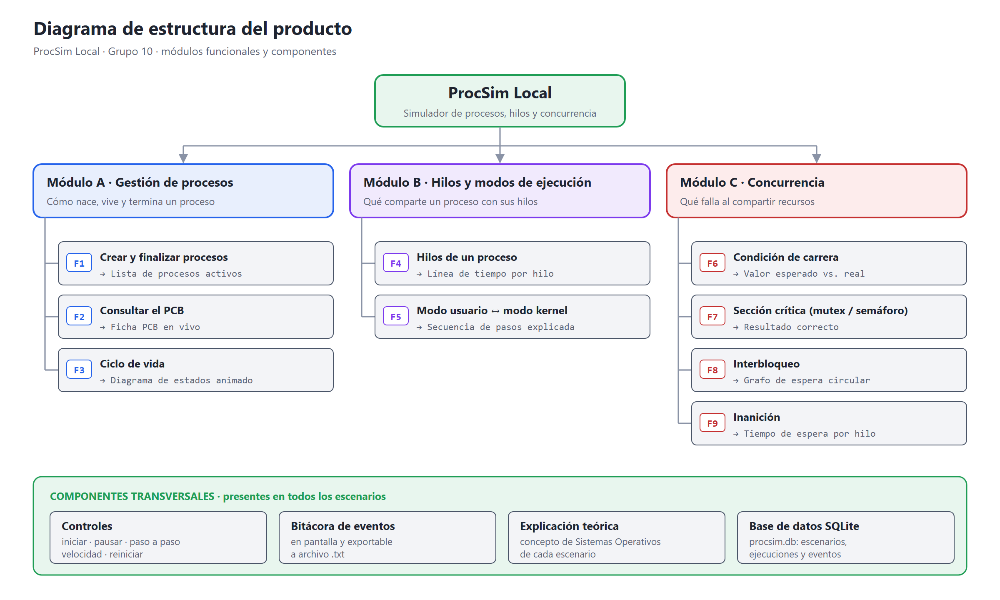
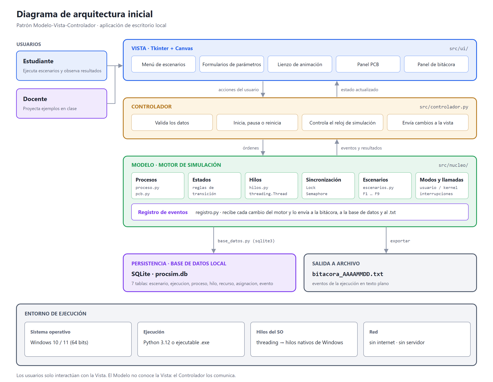
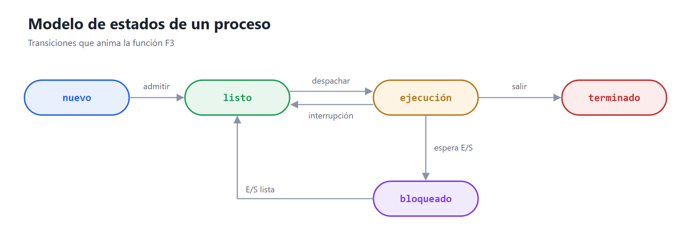
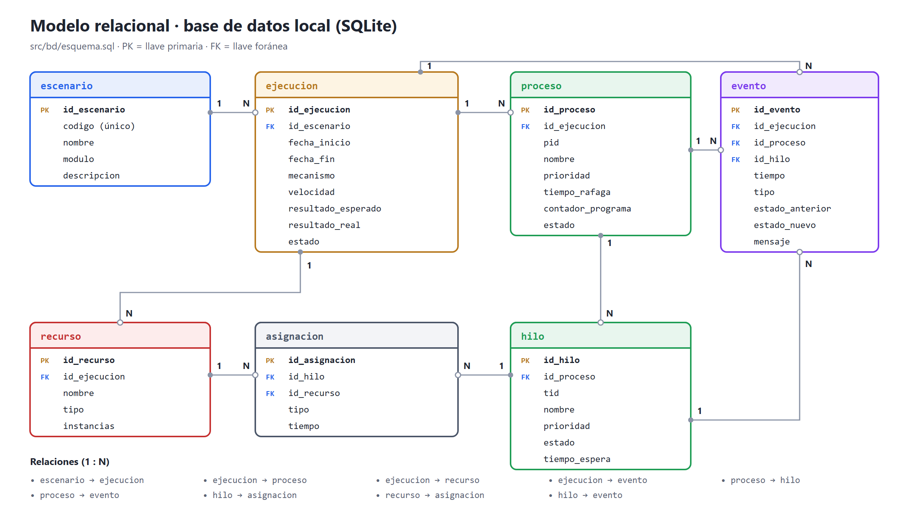

# Estructura del producto y arquitectura inicial

**Proyecto:** ProcSim Local · **Asignatura:** Sistemas Operativos · **Grupo:** 10

---

## 1. Diagrama de estructura del producto



El producto se organiza en **3 módulos funcionales** con **9 funciones**. Además tiene **componentes transversales** que comparten todos los escenarios: controles de simulación, bitácora, explicación teórica y base de datos.

## 2. Módulos funcionales

| Módulo | Propósito | Funciones | Archivos principales |
|---|---|---|---|
| **A · Gestión de procesos** | Cómo nace, vive y termina un proceso. | F1 Crear y finalizar procesos · F2 Consultar el PCB · F3 Ciclo de vida | `nucleo/proceso.py`, `nucleo/pcb.py`, `ui/panel_procesos.py` |
| **B · Hilos y modos de ejecución** | Qué comparte un proceso con sus hilos y cuándo se entra al kernel. | F4 Hilos de un proceso · F5 Modo usuario ↔ modo kernel | `nucleo/hilos.py`, `nucleo/escenarios.py`, `ui/panel_procesos.py` |
| **C · Concurrencia** | Qué falla cuando varios hilos comparten recursos y cómo se corrige. | F6 Condición de carrera · F7 Sección crítica · F8 Interbloqueo · F9 Inanición | `nucleo/sincronizacion.py`, `nucleo/escenarios.py`, `ui/panel_concurrencia.py` |

## 3. Diagrama de arquitectura inicial



La aplicación sigue el patrón **Modelo-Vista-Controlador (MVC)**.

## 4. Componentes principales del sistema

| Componente | Capa | Responsabilidad | Ubicación |
|---|---|---|---|
| Punto de entrada | — | Crea la ventana principal y arranca el controlador. | `src/main.py` |
| Ventana principal | Vista | Menú de escenarios, controles de simulación y panel de bitácora. | `src/ui/ventana_principal.py` |
| Panel de procesos | Vista | Lista de procesos, ficha PCB, diagrama de estados, línea de tiempo por hilo y secuencia usuario/kernel. | `src/ui/panel_procesos.py` |
| Panel de concurrencia | Vista | Contador compartido, comparación con mutex o semáforo, grafo de espera y tiempos de espera. | `src/ui/panel_concurrencia.py` |
| Controlador | Controlador | Valida los datos, inicia, pausa o reinicia, controla el reloj de simulación y envía los cambios a la vista. | `src/controlador.py` |
| Proceso y PCB | Modelo | Representan un proceso simulado y su bloque de control. | `src/nucleo/proceso.py`, `src/nucleo/pcb.py` |
| Hilos | Modelo | Crean hilos reales con `threading.Thread`. | `src/nucleo/hilos.py` |
| Sincronización | Modelo | Ofrecen los mecanismos ninguno, mutex (`Lock`) y semáforo (`Semaphore`). | `src/nucleo/sincronizacion.py` |
| Escenarios | Modelo | Definen la lógica de cada una de las 9 funciones. | `src/nucleo/escenarios.py` |
| Registro de eventos | Modelo | Recibe cada cambio del motor y lo envía a la bitácora, a la base de datos y al `.txt`. | `src/nucleo/registro.py` |
| Acceso a datos | Persistencia | Crea la base de datos y guarda o consulta ejecuciones y eventos. | `src/nucleo/base_datos.py` |
| Esquema de la base de datos | Persistencia | Tablas, llaves y restricciones. | `src/bd/esquema.sql` |

### Flujo de una simulación

1. El usuario elige un escenario y sus parámetros en la **Vista**.
2. El **Controlador** valida los datos y le pide al **Modelo** que prepare el escenario.
3. El Modelo crea los procesos, los PCB y los hilos. Cada cambio de estado genera un **evento**.
4. El **Registro de eventos** guarda el evento en la base de datos y lo entrega al Controlador.
5. El Controlador envía el cambio a la Vista, que actualiza la animación, la ficha PCB y la bitácora.
6. Al terminar, se guarda el resultado esperado y el real, y el usuario puede exportar la bitácora a `.txt`.

### Decisiones técnicas

- **La interfaz no se congela.** Tkinter solo puede actualizarse desde el hilo principal. Los hilos de la simulación ponen sus eventos en una cola (`queue.Queue`) y la Vista la revisa periódicamente con `after()`.
- **Condición de carrera repetible.** En CPython, `contador += 1` casi nunca falla por sí solo. Para que el error se vea siempre, cada hilo lee el valor, hace una pausa corta (`time.sleep`) y luego escribe. Esa pausa fuerza el cambio de contexto entre la lectura y la escritura, que es justo donde ocurre la carrera.
- **Interbloqueo sin congelar la aplicación.** Los hilos piden el segundo recurso con `acquire(timeout=...)`. Si se vence el tiempo, el sistema registra el interbloqueo, dibuja el grafo de espera y libera los recursos para poder reiniciar.

## 5. Modelo de estados de un proceso



| Transición | Motivo |
|---|---|
| nuevo → listo | **admitir**: el proceso fue creado y entra a la cola de listos. |
| listo → ejecución | **despachar**: el planificador le asigna la CPU. |
| ejecución → listo | **interrupción**: se acaba su tiempo o llega uno de mayor prioridad. |
| ejecución → bloqueado | **espera E/S**: pidió una operación de entrada/salida. |
| bloqueado → listo | **E/S lista**: terminó la operación de entrada/salida. |
| ejecución → terminado | **salir**: completó su ráfaga o fue finalizado. |

## 6. Base de datos y modelo relacional

La base de datos es **SQLite**: un solo archivo local (`procsim.db`), sin servidor. El módulo `sqlite3` viene incluido en Python. El esquema completo está en [`src/bd/esquema.sql`](../src/bd/esquema.sql).



| Tabla | Qué guarda | Relaciones |
|---|---|---|
| `escenario` | Catálogo de las 9 funciones (F1 a F9) y su módulo. | 1 escenario → N ejecuciones |
| `ejecucion` | Cada vez que se corre un escenario: fecha, mecanismo, velocidad, resultado esperado y real. | 1 ejecución → N procesos, recursos y eventos |
| `proceso` | Procesos simulados con los datos de su PCB. | 1 proceso → N hilos y eventos |
| `hilo` | Hilos de cada proceso, con prioridad y tiempo de espera. | 1 hilo → N asignaciones y eventos |
| `recurso` | Recursos compartidos (variable, dispositivo, archivo). | 1 recurso → N asignaciones |
| `asignacion` | Qué hilo **retiene** o **espera** qué recurso; con esto se dibuja el grafo de interbloqueo. | N : 1 con hilo y con recurso |
| `evento` | La bitácora: cada evento con tiempo, tipo, estados y mensaje. | N : 1 con ejecución, proceso e hilo |

## 7. Organización de archivos y directorios

```
ProcSimLocal_SistemasOperativos_G10/
├── README.md                      # presentación del proyecto
├── LICENSE                        # licencia MIT
├── documentacion/                 # documentación técnica
│   ├── descripcion_proyecto.md / .pdf
│   ├── requerimientos.md / .pdf
│   ├── arquitectura_inicial.md / .pdf
│   ├── tecnologias_herramientas.md / .pdf
│   ├── referencias.md / .pdf
│   ├── documento_tecnico.pdf      # documento consolidado para la entrega
│   └── diagramas/                 # diagramas en .svg y .png
├── src/                           # código fuente
│   ├── main.py                    # punto de entrada
│   ├── controlador.py             # CONTROLADOR
│   ├── ui/                        # VISTA (Tkinter)
│   │   ├── ventana_principal.py
│   │   ├── panel_procesos.py
│   │   └── panel_concurrencia.py
│   ├── nucleo/                    # MODELO (motor de simulación)
│   │   ├── proceso.py
│   │   ├── pcb.py
│   │   ├── hilos.py
│   │   ├── sincronizacion.py
│   │   ├── escenarios.py
│   │   ├── registro.py
│   │   └── base_datos.py
│   └── bd/
│       └── esquema.sql            # modelo relacional (SQLite)
├── recursos/
│   └── imagenes/                  # capturas e íconos
└── pruebas/                       # casos de prueba (unittest)
```

## 8. Sistema operativo y entorno de ejecución previsto

| Aspecto | Definición |
|---|---|
| Sistema operativo | Windows 10 / 11 de 64 bits. |
| Entorno | Python 3.12 durante el desarrollo; ejecutable `.exe` (PyInstaller) para los usuarios. |
| Hilos | `threading` crea hilos nativos de Windows, planificados por el sistema operativo. |
| Datos | Archivo local `procsim.db` (SQLite) en la carpeta de la aplicación. |
| Red | No requiere internet ni servidor. |
