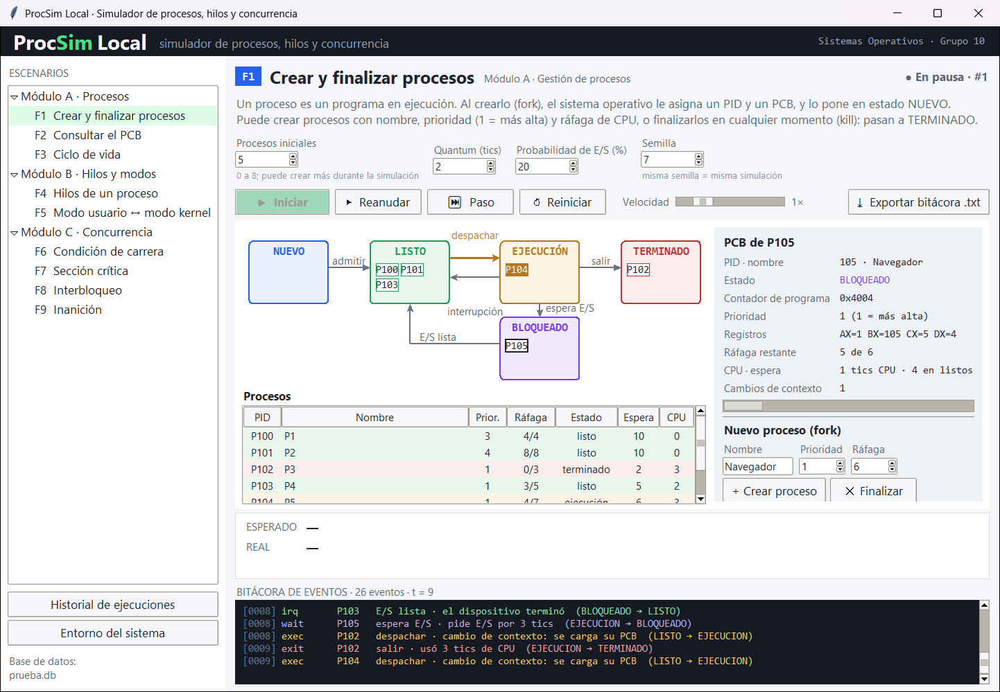
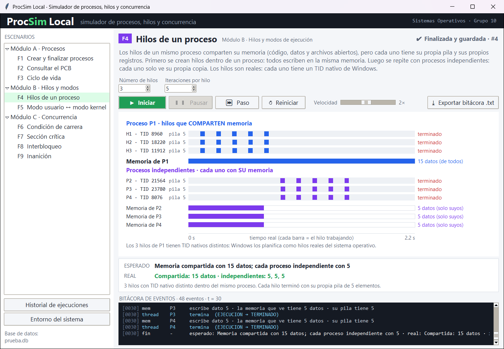
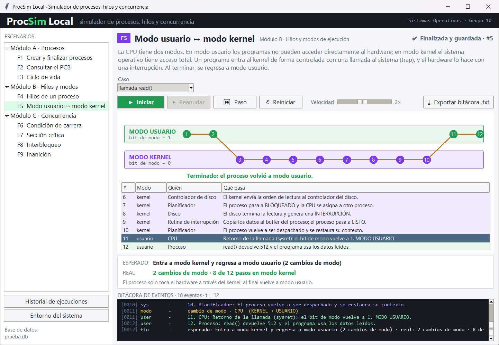
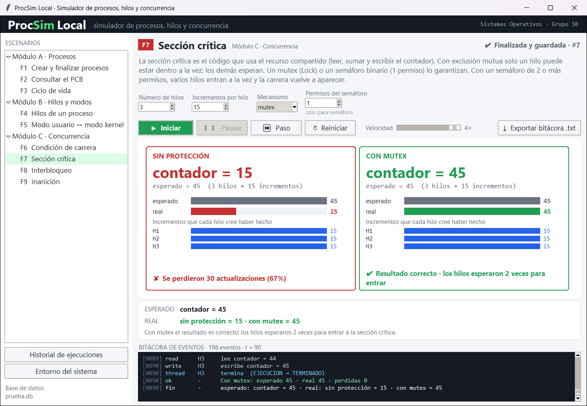
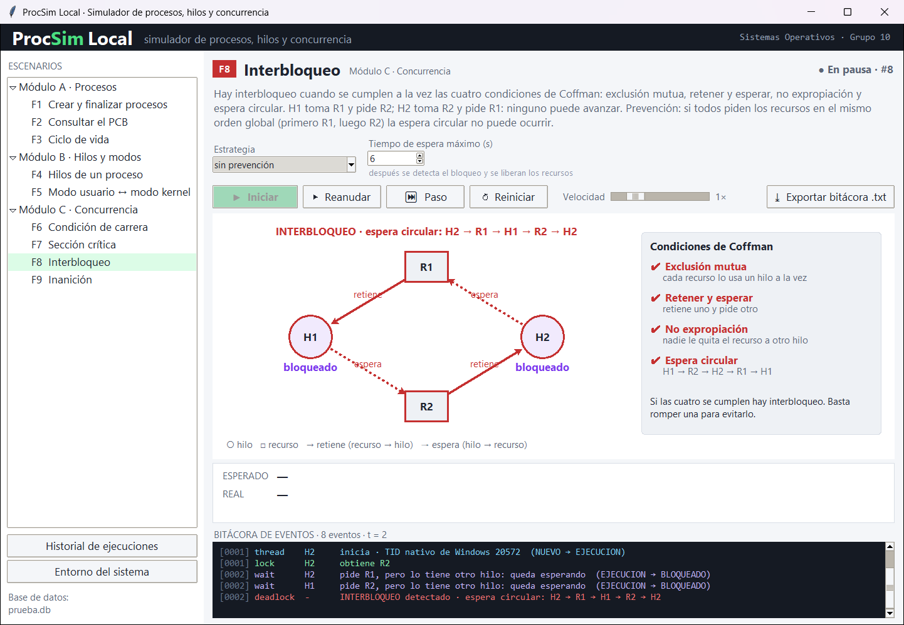
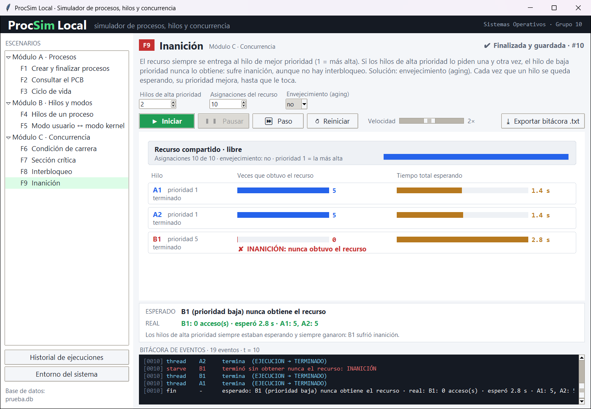
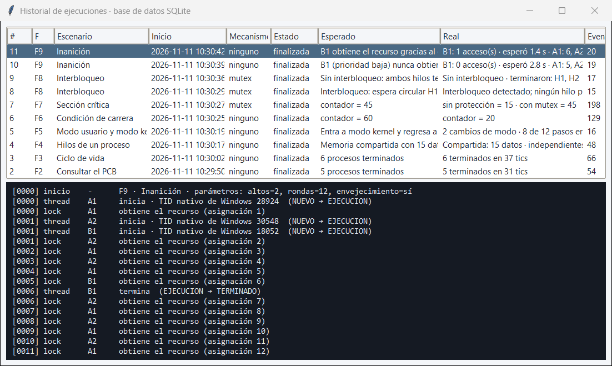

# Fase II · Avance de implementación

**Proyecto:** ProcSim Local · **Asignatura:** Sistemas Operativos · **Grupo:** 10
**Modalidad de entrega:** Opción A · Repositorio GitHub

---

## 1. Resumen del avance

En la Fase I se definieron el producto, su arquitectura y su modelo de datos. En esta fase se **implementó el prototipo funcional completo**:

| Componente | Estado |
|---|---|
| Motor de simulación (`src/nucleo/`): procesos, PCB, planificador, hilos, sincronización y 9 escenarios | ✅ Implementado |
| Base de datos SQLite (`src/bd/esquema.sql`, `src/nucleo/base_datos.py`) | ✅ Implementada; guarda cada ejecución |
| Controlador MVC (`src/controlador.py`) | ✅ Implementado |
| Interfaz gráfica Tkinter (`src/ui/`): 6 paneles, controles, bitácora e historial | ✅ Implementada |
| Las 9 funciones F1 a F9 | ✅ Funcionando |
| Pruebas automáticas (`pruebas/`) | ✅ 42 pruebas, todas pasan |
| Verificación del entorno (`src/entorno.py`) | ✅ Implementada |
| Ejecutable `.exe` y manual de usuario | ⏳ Fase III |

El código fuente suma unas 2.900 líneas de Python más el esquema SQL. Las pruebas son otras 460 líneas.

## 2. Configuración del sistema operativo y del entorno de trabajo

### 2.1 Entorno utilizado

Salida de `python src/entorno.py` en el equipo de desarrollo ([evidencia](evidencias/entorno.txt)):

```
Sistema operativo         Windows 11 (build 10.0.26200)
Arquitectura              AMD64
Procesadores lógicos      12
Python                    3.12.10
Intérprete                CPython
Tkinter (Tk)              8.6
SQLite                    3.49.1
Hilos nativos de prueba   3 TID distintos: 3040, 14588, 21000
Entorno correcto: se puede ejecutar  python src/main.py
```

La última comprobación crea 3 hilos con `threading` y lee su identificador nativo (`threading.get_native_id()`). Que salgan 3 TID distintos demuestra que cada hilo de Python es un **hilo real de Windows**, planificado por el sistema operativo. Los escenarios de concurrencia se apoyan en eso.

### 2.2 Pasos de instalación

1. Instalar **Python 3.12** para Windows desde python.org y marcar *"Add python.exe to PATH"* y *"tcl/tk and IDLE"* (Tkinter).
2. Clonar el repositorio:
   ```bash
   git clone https://github.com/felipearenas256-dot/ProcSimLocal_SistemasOperativos_G10.git
   cd ProcSimLocal_SistemasOperativos_G10
   ```
3. Verificar el entorno: `python src/entorno.py`
4. Ejecutar el simulador: `python src/main.py`
5. Ejecutar las pruebas: `python -m unittest discover -s pruebas -v`

No hay que instalar paquetes adicionales: Tkinter, `threading`, `queue`, `sqlite3` y `unittest` vienen con Python. La base de datos `procsim.db` se crea sola la primera vez, en la carpeta del proyecto (no se sube al repositorio).

### 2.3 Configuración de la aplicación

- **DPI en Windows:** `main.py` activa `SetProcessDpiAwareness` para que la ventana se vea nítida en pantallas con escala.
- **Base de datos:** por defecto `procsim.db`; se puede usar otra con `python src/main.py --bd otra.db`.
- **Velocidad:** el retardo base de cada paso es 0,35 s y se ajusta en la ventana entre 0,25× y 4×.

## 3. Componentes implementados

### 3.1 Modelo · motor de simulación (`src/nucleo/`)

| Archivo | Responsabilidad | Concepto de SO |
|---|---|---|
| `pcb.py` | Clase `PCB`: PID, estado, contador de programa, prioridad, registros AX–DX, ráfaga, tiempos y cambios de contexto. | Bloque de control de proceso |
| `proceso.py` | Clase `Proceso` con el modelo de 5 estados y validación de transiciones (`TransicionInvalida`). Clase `Planificador`: planificación por **prioridad con quantum** (round robin entre iguales), expropiación, E/S simulada y cambios de contexto. | Ciclo de vida, planificación, cambio de contexto |
| `hilos.py` | `HiloSimulado` (subclase de `threading.Thread`) con pila y registros propios y memoria compartida del proceso; guarda su TID nativo. `LineaTiempo` registra cuándo trabajó cada hilo. | Hilos |
| `sincronizacion.py` | `ControlEjecucion` (pausa, paso a paso, velocidad, detener); mecanismos ninguno / mutex (`Lock`) / semáforo (`Semaphore`); `GrafoEspera` con **detección de ciclos**; `RecursoConPrioridad` con **envejecimiento**. | Exclusión mutua, interbloqueo, inanición |
| `escenarios.py` | Los 9 escenarios F1–F9. Cada uno declara sus parámetros, se ejecuta en un hilo trabajador, expone su estado para la vista y devuelve un `Resultado` (esperado vs. real). | Todos |
| `registro.py` | Bitácora segura para hilos: reloj de simulación, lista de eventos, cola (`queue.Queue`) hacia la interfaz y exportación a `.txt`. | — |
| `base_datos.py` | Crea la base de datos desde `esquema.sql` y guarda cada ejecución en una transacción: procesos, hilos, recursos, asignaciones y eventos. Historial y consulta de eventos. | — |

### 3.2 Controlador (`src/controlador.py`)

Valida los parámetros, crea el escenario y lo ejecuta en un **hilo trabajador** para que la ventana no se congele. También:

- reenvía las órdenes pausar, reanudar, paso, velocidad y reiniciar;
- permite crear y finalizar procesos en vivo (F1);
- al terminar o al reiniciar, guarda todo en SQLite con el estado `finalizada` o `cancelada`.

### 3.3 Vista (`src/ui/`)

| Archivo | Contenido |
|---|---|
| `ventana_principal.py` | Menú de escenarios por módulo, formulario de parámetros generado a partir de cada escenario, controles, franja de resultado (esperado vs. real), bitácora con colores por tipo de evento, historial de la base de datos y datos del entorno. |
| `panel_procesos.py` | **F1–F3:** diagrama de 5 estados animado con los procesos dentro de cada estado, tabla de procesos, ficha PCB en vivo y formulario para crear o finalizar procesos. **F4:** línea de tiempo por hilo con su TID nativo y memoria compartida frente a memoria propia. **F5:** carriles de modo usuario y modo kernel paso a paso. |
| `panel_concurrencia.py` | **F6/F7:** contador esperado vs. real y comparación sin protección / con mutex o semáforo. **F8:** grafo de asignación de recursos con la espera circular resaltada y las 4 condiciones de Coffman. **F9:** accesos y tiempo de espera por hilo, con la prioridad efectiva. |
| `tema.py` | Colores, fuentes y utilidades de dibujo. |

### 3.4 Decisiones técnicas importantes

1. **La interfaz nunca se congela.** Tkinter solo puede actualizarse desde el hilo principal. Los hilos de la simulación ponen sus eventos en una `queue.Queue`, y la ventana la lee cada 80 ms con `after()`.
2. **Condición de carrera repetible.** Cada hilo lee el contador, llega a un punto de control (pausa corta o paso del usuario) y luego escribe. Ahí el sistema operativo cambia de hilo, y otro lee el mismo valor viejo. Con "Paso" se ve exactamente esa intercalación en la bitácora.
3. **Interbloqueo real sin congelar la aplicación.** Los hilos usan `Lock` reales. Un monitor revisa el grafo de espera y detecta el ciclo. Cada hilo tiene un tiempo de espera máximo para soltar sus recursos, así el bloqueo se rompe y la app sigue respondiendo.
4. **Paso a paso con hilos reales.** `ControlEjecucion.punto_control()` usa una `threading.Condition`: en pausa, los hilos esperan, y cada "Paso" deja avanzar exactamente un punto de control.
5. **Simulación reproducible.** El planificador usa una semilla: la misma semilla produce la misma secuencia de eventos (lo verifica una prueba).

### 3.5 Base de datos

El esquema de la Fase I se implementó sin cambios estructurales: 7 tablas con llaves primarias, llaves foráneas y restricciones `CHECK`. Después de ejecutar los 9 escenarios ([evidencia](evidencias/consulta_base_datos.txt)):

| Tabla | Registros |
|---|---|
| escenario | 9 |
| ejecucion | 12 |
| proceso | 33 |
| hilo | 22 |
| recurso | 9 |
| asignacion | 9 |
| evento | 710 |

La tabla `asignacion` guarda el grafo del interbloqueo: `H1 retiene R1`, `H2 retiene R2`, `H2 espera R1`, `H1 espera R2`.

## 4. Funcionalidades implementadas

| # | Función | Requerimientos | Estado | Evidencia |
|---|---|---|---|---|
| F1 | Crear y finalizar procesos | RF-01, RF-02, RF-03 | ✅ | [captura](../recursos/imagenes/fase2/01_F1_crear_procesos.png) |
| F2 | Consultar el PCB | RF-04 | ✅ | [captura](../recursos/imagenes/fase2/02_F2_pcb.png) |
| F3 | Ciclo de vida | RF-05 | ✅ | [captura](../recursos/imagenes/fase2/03_F3_ciclo_de_vida.png) · [bitácora](evidencias/bitacora_F3_ciclo_de_vida.txt) |
| F4 | Hilos de un proceso | RF-06, RF-07 | ✅ | [captura](../recursos/imagenes/fase2/04_F4_hilos.png) |
| F5 | Modo usuario ↔ modo kernel | RF-08 | ✅ | [captura](../recursos/imagenes/fase2/05_F5_modo_kernel.png) |
| F6 | Condición de carrera | RF-09 | ✅ | [captura](../recursos/imagenes/fase2/06_F6_condicion_carrera.png) · [bitácora](evidencias/bitacora_F6_condicion_carrera.txt) |
| F7 | Sección crítica | RF-10 | ✅ | [captura](../recursos/imagenes/fase2/07_F7_seccion_critica_mutex.png) |
| F8 | Interbloqueo | RF-11 | ✅ | [captura](../recursos/imagenes/fase2/08_F8_interbloqueo.png) · [prevención](../recursos/imagenes/fase2/09_F8_prevencion_orden.png) · [bitácora](evidencias/bitacora_F8_interbloqueo.txt) |
| F9 | Inanición | RF-12 | ✅ | [captura](../recursos/imagenes/fase2/10_F9_inanicion.png) · [envejecimiento](../recursos/imagenes/fase2/11_F9_envejecimiento.png) |
| — | Menú, parámetros validados, controles | RF-13, RF-14, RF-15 | ✅ | todas las capturas |
| — | Bitácora en pantalla, base de datos, historial, exportar `.txt` | RF-16 a RF-19 | ✅ | [historial](../recursos/imagenes/fase2/12_historial_base_datos.png) |
| — | Explicación teórica de cada escenario | RF-20 | ✅ | todas las capturas |

## 5. Pruebas de funcionamiento

### 5.1 Pruebas automáticas (`unittest`)

Comando: `python -m unittest discover -s pruebas -v` · Resultado: **42 pruebas, todas correctas, en unos 10 s** ([salida completa](evidencias/pruebas_unittest.txt)). La suite se ejecutó varias veces seguidas para comprobar que las pruebas con hilos reales son estables.

| Archivo | Pruebas | Qué verifica |
|---|---|---|
| `test_procesos.py` | 12 | PCB y contador de programa; transiciones válidas e inválidas; asignación y validación de PID, prioridad y ráfaga; que todos los procesos terminen; un solo proceso en CPU a la vez; expropiación por prioridad; turnos por quantum; misma semilla = misma simulación; finalizar procesos. |
| `test_hilos_modos.py` | 6 | Memoria compartida (n × k datos) frente a memoria propia (k); TID nativos distintos; pila propia de cada hilo; línea de tiempo; 2 cambios de modo en `read()` y en la interrupción. |
| `test_concurrencia.py` | 15 | Sin protección se pierden actualizaciones; mutex y semáforo binario dan el resultado exacto; un semáforo de 2 permisos no protege; detección de ciclos en el grafo; interbloqueo sin prevención y su prevención con orden global; inanición y su corrección con envejecimiento; pausa, paso a paso, detener y límites de velocidad. |
| `test_base_datos_controlador.py` | 9 | Esquema y datos iniciales; llaves foráneas y `CHECK`; validación de parámetros; ejecución completa guardada (procesos, hilos, recursos, asignaciones y eventos); crear procesos en vivo; reiniciar guarda `cancelada`; no iniciar dos simulaciones a la vez; exportar la bitácora. |

### 5.2 Pruebas funcionales en la interfaz

Se ejecutó cada escenario desde la ventana y se comparó el resultado esperado con el obtenido (los datos quedaron en la base de datos):

| Escenario y parámetros | Esperado | Obtenido | ¿Cumple? |
|---|---|---|---|
| F1 · 5 procesos + "Navegador" creado en vivo | 6 procesos terminados | 6 terminados en 43 tics | ✅ |
| F2 · 5 procesos | PCB actualizado en cada tic | PC, registros y tiempos cambian en vivo | ✅ |
| F3 · 6 procesos, 30 % de E/S | Recorre los 5 estados | 6 terminados en 37 tics, con E/S e interrupciones | ✅ |
| F4 · 3 hilos × 5 iteraciones | Compartida 15; propias 5 | Compartida 15 · independientes 5, 5, 5 | ✅ |
| F5 · llamada `read()` | 2 cambios de modo | 2 cambios · 8 de 12 pasos en kernel | ✅ |
| F6 · 3 hilos × 20 | contador ≠ 60 (carrera) | contador = 20 (se perdió el 67 %) | ✅ se demuestra la carrera |
| F7 · mutex, 3 hilos × 15 | 45 | sin protección 15 · con mutex 45 | ✅ |
| F8 · sin prevención | Espera circular | Interbloqueo H1 → R2 → H2 → R1 → H1 detectado | ✅ |
| F8 · orden global | Sin interbloqueo | Terminaron H1 y H2 | ✅ |
| F9 · sin envejecimiento | B1 nunca obtiene el recurso | B1: 0 accesos · A1: 5, A2: 5 | ✅ se demuestra la inanición |
| F9 · con envejecimiento | B1 obtiene el recurso | B1: 1 acceso | ✅ |

## 6. Evidencias del desarrollo

- **Capturas de la aplicación:** [`recursos/imagenes/fase2/`](../recursos/imagenes/fase2/) (12 capturas).
- **Evidencias en texto:** [`documentacion/evidencias/`](evidencias/): entorno, salida de las pruebas, bitácoras exportadas y consulta a la base de datos.
- **Historial de commits:** cada componente se subió en su propio commit (motor, controlador, interfaz, pruebas, correcciones y evidencias).

### Gestión de procesos (F1 · F2 · F3)


### Hilos (F4)


### Modo usuario y modo kernel (F5)


### Condición de carrera y sección crítica (F6 · F7)


### Interbloqueo (F8)


### Inanición (F9)


### Historial en la base de datos


## 7. Próximos avances (Fase III)

1. Ejecutable `.exe` con PyInstaller y prueba en un equipo sin Python.
2. Manual de usuario con capturas.
3. Análisis de resultados de los casos de prueba.
4. Mejoras de la interfaz según la retroalimentación del docente.
