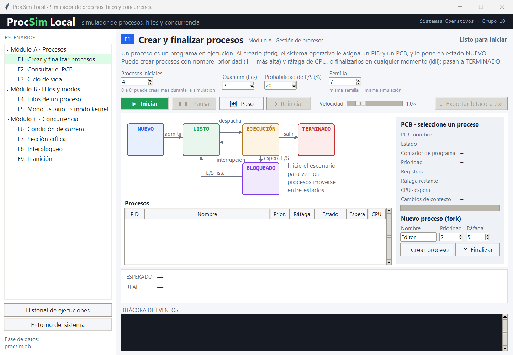
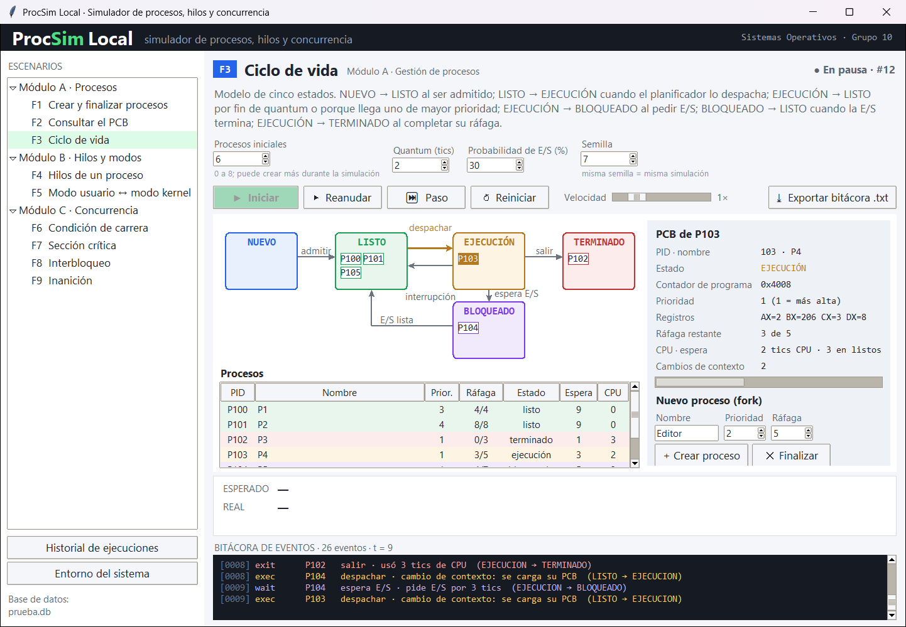
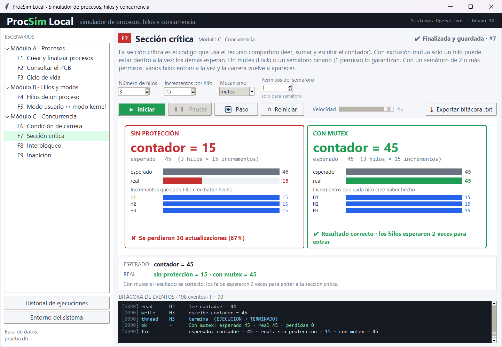
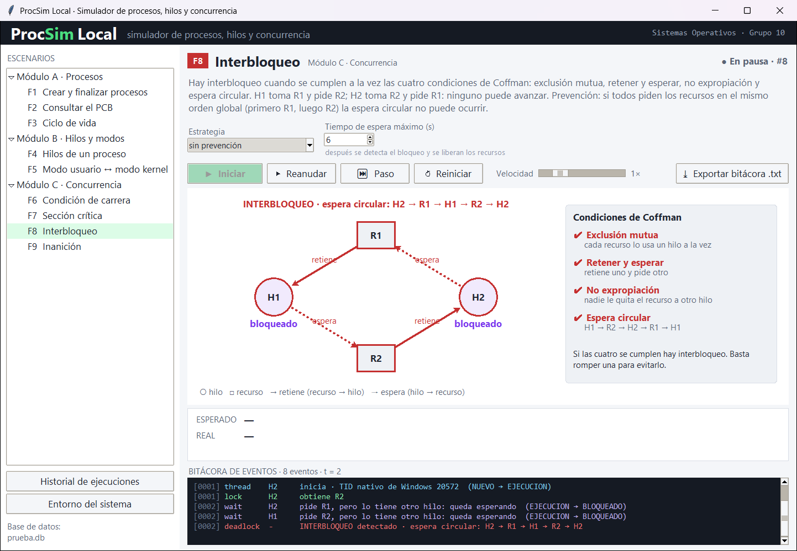
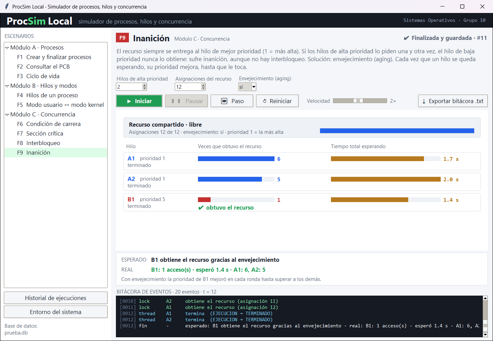
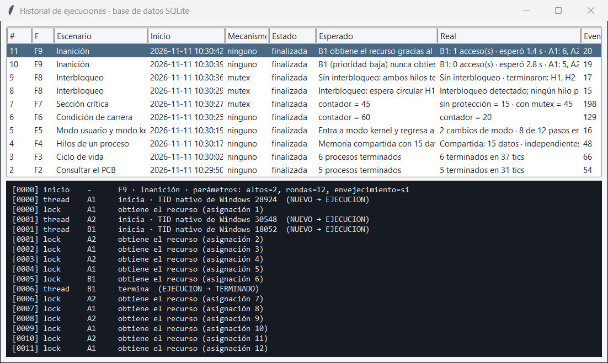

# Fase III · Entrega final

**Proyecto:** ProcSim Local · **Asignatura:** Sistemas Operativos · **Grupo:** 10
**Modalidad de entrega:** Opción A · Repositorio GitHub
**Repositorio:** <https://github.com/felipearenas256-dot/ProcSimLocal_SistemasOperativos_G10>

---

## 1. Resumen del resultado final

ProcSim Local quedó terminado como una **aplicación de escritorio para Windows** que simula de forma visual e interactiva la gestión de procesos e hilos y los problemas clásicos de concurrencia. La solución final reúne lo construido en las tres fases:

| Fase | Aporte a la versión final |
|---|---|
| **I. Planeación** | Problemática, objetivos, alcance, requerimientos (RF-01 a RF-20, RNF-01 a RNF-15), arquitectura MVC, modelo relacional y diagramas. |
| **II. Implementación** | Motor de simulación, base de datos SQLite, controlador, interfaz con las 9 funciones, 42 pruebas automáticas y evidencias. |
| **III. Entrega final** | Ejecutable `.exe` para Windows, manual de usuario, experimentos repetidos con análisis de resultados, corrección de la interfaz y documentación consolidada. |

| Entregable | Dónde está |
|---|---|
| Código fuente organizado (MVC) | [`src/`](../src/) |
| Ejecutable para Windows | [Releases del repositorio](https://github.com/felipearenas256-dot/ProcSimLocal_SistemasOperativos_G10/releases) · se genera con [`empaquetar.bat`](../empaquetar.bat) |
| Manual de usuario | [`manual_usuario.md`](manual_usuario.md) · [PDF](manual_usuario.pdf) |
| Pruebas automáticas (42) | [`pruebas/`](../pruebas/) · [salida](evidencias/pruebas_unittest.txt) |
| Experimentos y resultados | [`src/experimentos.py`](../src/experimentos.py) · [resultados](evidencias/resultados_experimentos.md) |
| Evidencias (capturas y textos) | [`recursos/imagenes/`](../recursos/imagenes/) · [`evidencias/`](evidencias/) |
| Documentación de las fases anteriores | [`documento_tecnico.pdf`](documento_tecnico.pdf) (Fase I) · [`fase2_avance.md`](fase2_avance.md) (Fase II) |

## 2. Solución implementada

La aplicación sigue el patrón **Modelo-Vista-Controlador**:

| Capa | Archivos | Responsabilidad |
|---|---|---|
| **Modelo** | `src/nucleo/` (`pcb.py`, `proceso.py`, `hilos.py`, `sincronizacion.py`, `escenarios.py`, `registro.py`, `base_datos.py`) | PCB, modelo de 5 estados con transiciones validadas, planificador por prioridad con quantum y expropiación, hilos reales, mutex, semáforos, grafo de espera, recurso con prioridad y envejecimiento, los 9 escenarios, bitácora y persistencia. |
| **Controlador** | `src/controlador.py` | Valida los parámetros, ejecuta la simulación en un hilo trabajador, atiende pausa, paso, velocidad y reinicio, y guarda cada ejecución en la base de datos. |
| **Vista** | `src/ui/` | Ventana Tkinter con menú de escenarios, formularios, lienzos animados, ficha PCB, bitácora e historial. |
| **Persistencia** | `src/bd/esquema.sql` | 7 tablas SQLite: escenario, ejecución, proceso, hilo, recurso, asignación y evento. |

Los procesos de los escenarios F1 a F3 son **simulados** (el planificador avanza por tics), mientras que los hilos de F4 y F6 a F9 son **hilos reales del sistema operativo**: Windows los planifica, por eso la condición de carrera, el interbloqueo y la inanición que se ven en pantalla ocurren de verdad.

### Funciones entregadas

| Módulo | Función | Estado |
|---|---|---|
| A · Gestión de procesos | F1 Crear y finalizar procesos · F2 Consultar el PCB · F3 Ciclo de vida | ✅ |
| B · Hilos y modos | F4 Hilos de un proceso · F5 Modo usuario ↔ kernel | ✅ |
| C · Concurrencia | F6 Condición de carrera · F7 Sección crítica · F8 Interbloqueo · F9 Inanición | ✅ |
| Transversal | Controles (iniciar, pausar, paso, velocidad, reiniciar), bitácora exportable, historial en SQLite, explicación teórica | ✅ |

## 3. Configuración del sistema operativo y del entorno

| Elemento | Valor |
|---|---|
| Sistema operativo | Windows 11 Home (build 10.0.26200), 64 bits, 12 procesadores lógicos |
| Lenguaje | Python 3.12.10 (CPython) |
| Interfaz | Tkinter / Tk 8.6 |
| Base de datos | SQLite 3.49.1, local, sin servidor |
| Empaquetado | PyInstaller 6 → `ProcSimLocal.exe` (un solo archivo, unos 12 MB) |

- `python src/entorno.py` comprueba el entorno y crea 3 hilos para verificar que reciben **TID nativos distintos** de Windows ([evidencia](evidencias/entorno.txt)).
- `main.py` activa el modo *DPI aware* de Windows para que la ventana se vea nítida en pantallas con escala.
- **Ejecutable:** `empaquetar.bat` instala PyInstaller y genera `dist\ProcSimLocal.exe`. El esquema SQL viaja dentro del ejecutable y la base de datos `procsim.db` se crea junto al `.exe`. Se probó en una carpeta limpia: la ventana abre y la base de datos se crea sola ([captura](../recursos/imagenes/fase3/01_ejecutable_windows.png)).

## 4. Pruebas de funcionamiento

| Tipo | Cómo se ejecuta | Resultado |
|---|---|---|
| Pruebas automáticas (unitarias y de integración) | `python -m unittest discover -s pruebas -v` | **42 de 42 correctas** ([salida](evidencias/pruebas_unittest.txt)) |
| Pruebas funcionales en la interfaz | Cada escenario ejecutado desde la ventana | 11 casos, todos cumplen ([tabla en la Fase II](fase2_avance.md#52-pruebas-funcionales-en-la-interfaz)) |
| Experimentos repetidos | `python src/experimentos.py -n 10` | 6 experimentos, 10 repeticiones por configuración (sección 5) |
| Prueba del ejecutable | `ProcSimLocal.exe` en una carpeta nueva | Abre la ventana y crea `procsim.db` |

Las pruebas automáticas cubren: PCB, transiciones válidas e inválidas, planificador (expropiación, quantum, determinismo con semilla), memoria compartida frente a memoria propia, TID nativos, cambios de modo, pérdida de actualizaciones sin protección, exactitud con mutex y semáforo binario, detección de ciclos en el grafo de espera, prevención por orden global, inanición y envejecimiento, controles de la simulación, base de datos (llaves foráneas y `CHECK`) y el controlador completo.

## 5. Resultados obtenidos

Los experimentos ejecutan cada escenario sin interfaz, con el mismo motor de la aplicación, y repiten cada configuración 10 veces. La salida completa está en [`evidencias/resultados_experimentos.md`](evidencias/resultados_experimentos.md).

### 5.1 Planificador (F1–F3): efecto del quantum

6 procesos, 20 % de E/S, semilla 7.

| Quantum | Tics totales | Cambios de contexto | Espera promedio (tics) |
|---|---|---|---|
| 1 | 34 | 20 | 10,33 |
| 2 | 34 | 18 | 10,17 |
| 3 | 34 | 15 | 10,17 |
| 4 | 34 | 15 | 10,17 |
| 5 | 34 | 15 | 10,17 |

**Análisis.** El trabajo total no cambia (34 tics), pero un quantum pequeño produce **más cambios de contexto** (20 con quantum 1 frente a 15 con quantum 3 o más). Es lo que predice la teoría: el quantum corto reparte mejor la CPU, pero el sistema operativo pierde más tiempo cambiando de proceso. A partir de quantum 3 casi ninguna ráfaga se interrumpe por tiempo y el resultado se estabiliza.

### 5.2 Hilos (F4) y modos (F5)

| Caso | Resultado |
|---|---|
| F4 con 2, 4 y 6 hilos × 5 iteraciones | Memoria compartida = hilos × 5 (10, 20, 30); cada proceso independiente = 5 |
| F5 · `read()` e interrupción de teclado | 2 cambios de modo en cada caso (usuario → kernel → usuario) |

**Análisis.** Los hilos de un mismo proceso ven y modifican la **misma memoria**; los procesos independientes no comparten nada. Cada hilo recibió un TID nativo distinto, lo que confirma que son hilos reales del sistema operativo.

### 5.3 Condición de carrera (F6)

50 incrementos por hilo, sin protección.

| Hilos | Valor esperado | Valor final | Actualizaciones perdidas | Corridas con carrera |
|---|---|---|---|---|
| 2 | 100 | 50 | 50 % | 10/10 |
| 4 | 200 | 50 | 75 % | 10/10 |
| 8 | 400 | 50 | 88 % | 10/10 |

**Análisis.** En todas las corridas se perdieron actualizaciones. El escenario deja una pausa entre la lectura y la escritura del contador para que el error sea visible: todos los hilos leen el mismo valor y escriben el mismo resultado, así que solo cuenta una de cada *n* sumas y la pérdida es (n − 1)/n. Con más hilos la pérdida crece.

### 5.4 Sección crítica (F7)

4 hilos × 50 incrementos (esperado 200).

| Mecanismo | Corridas correctas |
|---|---|
| Mutex | 10/10 |
| Semáforo binario (1 permiso) | 10/10 |
| Semáforo con 2 permisos | 0/10 |

**Análisis.** El mutex y el semáforo binario garantizan **exclusión mutua** y el resultado siempre es exacto. El semáforo de 2 permisos deja entrar a dos hilos a la vez a la sección crítica, así que no la protege: sirve para limitar recursos, no para exclusión mutua. La protección cuesta tiempo: las corridas protegidas tardan más porque los hilos esperan su turno.

### 5.5 Interbloqueo (F8)

2 hilos, 2 recursos, espera máxima de 1 s.

| Estrategia | Interbloqueos | Ambos hilos terminan | Duración promedio |
|---|---|---|---|
| Sin prevención | 10/10 | 0/10 | ≈ 1,1 s (hasta vencer la espera) |
| Orden global de recursos | 0/10 | 10/10 | ≈ 0,06 s |

**Análisis.** Sin prevención se cumplen las **4 condiciones de Coffman** y el grafo de espera muestra el ciclo H1 → R2 → H2 → R1 → H1 en todas las corridas. Al imponer un orden global de recursos se rompe la condición de **espera circular** y el interbloqueo desaparece por completo.

### 5.6 Inanición (F9)

2 hilos de alta prioridad y 1 de baja (B1).

| Asignaciones | Envejecimiento | Accesos de B1 | Corridas con inanición total |
|---|---|---|---|
| 12 | no | 0 | 10/10 |
| 12 | sí | 1 | 0/10 |
| 24 | no | 0 | 10/10 |
| 24 | sí | 1 | 0/10 |

**Análisis.** Con planificación por prioridad estricta, B1 **nunca** obtiene el recurso aunque se hagan más asignaciones: eso es inanición. Con envejecimiento (*aging*) su prioridad sube mientras espera y siempre consigue al menos un acceso.

## 6. Cumplimiento de los objetivos

| Objetivo específico | Cumplimiento | Evidencia |
|---|---|---|
| 1. Módulo de gestión de procesos (crear, finalizar, PCB, ciclo de vida) | ✅ | F1–F3, `test_procesos.py`, experimento 5.1 |
| 2. Módulo de hilos y modos de ejecución | ✅ | F4–F5, `test_hilos_modos.py`, experimento 5.2 |
| 3. Módulo de concurrencia con hilos reales | ✅ | F6–F9, `test_concurrencia.py`, experimentos 5.3 a 5.6 |
| 4. Interfaz gráfica con controles y explicación teórica | ✅ | Capturas en `recursos/imagenes/`, manual de usuario |
| 5. Base de datos SQLite y bitácora exportable | ✅ | `test_base_datos_controlador.py`, [consulta](evidencias/consulta_base_datos.txt), bitácoras exportadas |
| 6. Pruebas y documentación en GitHub | ✅ | 42 pruebas, experimentos, README, documentación de las 3 fases y commits por avance |

Los 20 requerimientos funcionales se trazan a las funciones en la [tabla de la Fase II](fase2_avance.md#4-funcionalidades-implementadas). Requerimientos no funcionales verificados:

| RNF | Cómo se cumple |
|---|---|
| RNF-01 · RNF-03 Windows y ejecutable | `ProcSimLocal.exe` probado en Windows 11 sin depender del código fuente. |
| RNF-02 Sin internet ni servidor | Todo corre y se guarda en el equipo (SQLite local). |
| RNF-06 Interfaz que responde | La simulación corre en un hilo trabajador; la ventana se actualiza con una cola de eventos. |
| RNF-08 Interbloqueo sin congelar | El tiempo de espera máximo detecta el bloqueo, libera los recursos y permite reiniciar (experimento 5.5). |
| RNF-09 Repetible | La misma semilla da la misma simulación (prueba automática y experimento 5.1). |
| RNF-10 Seguridad | No se tocan procesos reales del equipo; los procesos de F1–F3 son simulados. |
| RNF-11 Integridad de datos | Llaves foráneas y `CHECK` probadas en `test_base_datos_controlador.py`. |
| RNF-12 · RNF-14 MVC y pruebas | El motor no depende de la interfaz y tiene 42 pruebas con `unittest`. |
| RNF-15 Commits | Un commit por avance en cada fase. |

## 7. Evidencias

| | |
|---|---|
|  Ejecutable `.exe` en Windows 11 |  F3 · ciclo de vida |
|  F7 · sección crítica con mutex |  F8 · interbloqueo detectado |
|  F9 · envejecimiento |  Historial en SQLite |

- Capturas: [`recursos/imagenes/fase2/`](../recursos/imagenes/fase2/) (12) y [`recursos/imagenes/fase3/`](../recursos/imagenes/fase3/).
- Textos: entorno, salida de las pruebas, bitácoras exportadas de F3, F6 y F8, consulta a la base de datos y resultados de los experimentos en [`evidencias/`](evidencias/).
- Registro de avances: historial de commits del repositorio, un commit por componente o corrección.

## 8. Conclusiones

1. **La concurrencia se entiende mejor cuando se ve fallar.** Al usar hilos reales, la condición de carrera, el interbloqueo y la inanición no son animaciones preparadas: ocurren en el equipo y se pueden medir. Los experimentos lo confirman con resultados repetibles.
2. **Cada mecanismo de sincronización resuelve un problema distinto.** El mutex y el semáforo binario garantizan exclusión mutua; un semáforo con más permisos no. El orden global de recursos previene el interbloqueo rompiendo la espera circular, y el envejecimiento corrige la inanición.
3. **Las decisiones del planificador tienen un costo.** Un quantum pequeño reparte mejor la CPU pero aumenta los cambios de contexto; la expropiación por prioridad favorece a los procesos importantes pero puede dejar esperando a los demás.
4. **La arquitectura MVC y las pruebas automáticas facilitaron el desarrollo.** El motor se probó sin interfaz (42 pruebas y los experimentos), y la interfaz solo tuvo que dibujar el estado que el motor publica.
5. **Una herramienta local y sin instalación es práctica para el aula.** El `.exe` funciona en Windows sin Python ni internet, y cada ejecución queda guardada para repasarla después.

### Limitaciones y trabajo futuro

- Los procesos de F1 a F3 son simulados; el simulador no controla procesos reales del equipo (fuera del alcance definido).
- Se podrían agregar otros algoritmos de planificación (FCFS, SJF, Round Robin puro) para compararlos, y escenarios clásicos como productor-consumidor o los filósofos comensales.
- El ejecutable no tiene firma digital, por eso Windows SmartScreen muestra un aviso la primera vez.
