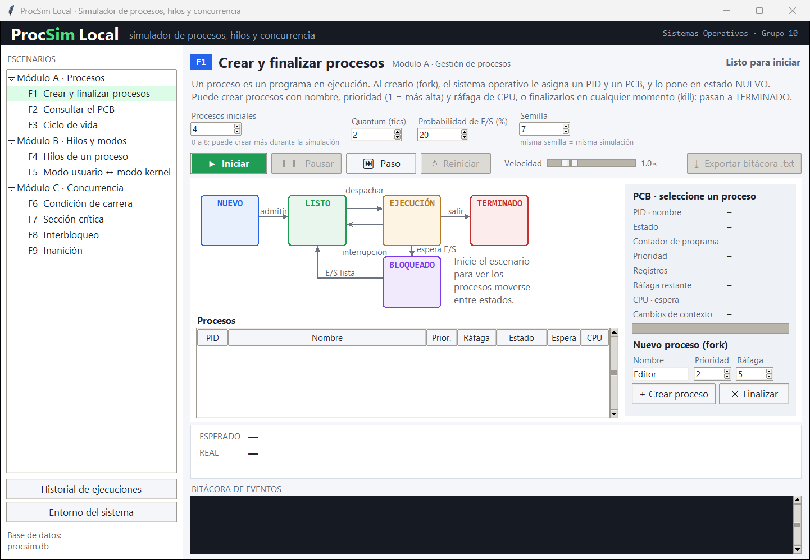

# Manual de usuario · ProcSim Local

**Simulador de procesos, hilos y concurrencia para Windows** · Sistemas Operativos · Grupo 10

---

## 1. ¿Qué es ProcSim Local?

ProcSim Local es una aplicación de escritorio que muestra, paso a paso, lo que hace un sistema operativo cuando crea y administra procesos e hilos, y cómo aparecen y se corrigen la condición de carrera, el interbloqueo y la inanición.

Tiene **9 escenarios** (F1 a F9) en 3 módulos. Cada escenario se configura, se ejecuta y se puede pausar o avanzar evento por evento. Todo lo que pasa queda en una bitácora y en una base de datos local.

No necesita internet ni cuenta de usuario.

## 2. Requisitos

| Recurso | Mínimo |
|---|---|
| Sistema operativo | Windows 10 u 11 de 64 bits |
| Memoria RAM | 4 GB |
| Disco | 200 MB libres |
| Pantalla | 1366 × 768 (recomendado 1920 × 1080) |
| Software | Ninguno con el `.exe`; Python 3.12 si se ejecuta desde el código |

## 3. Instalación y ejecución

### Opción 1 · Ejecutable (sin instalar Python)

1. Descargue `ProcSimLocal.exe` de la sección **Releases** del repositorio:
   <https://github.com/felipearenas256-dot/ProcSimLocal_SistemasOperativos_G10/releases>
2. Guárdelo en una carpeta propia, por ejemplo `Documentos\ProcSim`.
3. Haga doble clic en `ProcSimLocal.exe`. La primera apertura tarda unos segundos.
4. Si Windows muestra **"Windows protegió su PC"** (SmartScreen), haga clic en **Más información → Ejecutar de todas formas**. El aviso aparece porque el ejecutable no tiene firma digital comercial; no es un error.
5. Si aparece **"Una directiva de Control de aplicaciones bloqueó este archivo"**, el equipo tiene activo **Smart App Control** de Windows 11, que bloquea los programas sin firma digital y no ofrece la opción de ejecutarlos de todas formas. En ese caso use la **opción 2** (desde el código fuente): el resultado es el mismo.

La base de datos `procsim.db` se crea en la misma carpeta del `.exe`.

### Opción 2 · Desde el código fuente

```bash
git clone https://github.com/felipearenas256-dot/ProcSimLocal_SistemasOperativos_G10.git
cd ProcSimLocal_SistemasOperativos_G10
python src/entorno.py      # comprueba Windows, Python, Tkinter, SQLite e hilos nativos
python src/main.py         # abre el simulador
```

Al instalar Python 3.12 marque *"Add python.exe to PATH"* y *"tcl/tk and IDLE"*. No hay que instalar paquetes adicionales.

Para generar el ejecutable usted mismo: ejecute `empaquetar.bat` en la raíz del repositorio. El archivo queda en `dist\ProcSimLocal.exe`.

## 4. La ventana principal



| Zona | Para qué sirve |
|---|---|
| **Menú de escenarios** (izquierda) | Elegir F1 a F9, agrupados en Módulo A (procesos), B (hilos y modos) y C (concurrencia). |
| **Encabezado del escenario** | Código, nombre, módulo, estado de la simulación y una explicación corta del concepto teórico. |
| **Parámetros** | Datos del escenario (número de procesos, hilos, mecanismo, etc.). Debajo de cada campo se indica el rango permitido. |
| **Barra de controles** | Iniciar, Pausar / Reanudar, Paso, Reiniciar, Velocidad y Exportar bitácora. |
| **Área de visualización** | El dibujo del escenario: diagrama de estados, línea de tiempo, contador compartido, grafo de espera, etc. |
| **Esperado / Real** | Lo que la teoría predice y lo que realmente ocurrió en la ejecución. |
| **Bitácora de eventos** (abajo) | Cada evento con su número de tic y su tipo. |
| **Historial de ejecuciones** y **Entorno del sistema** (abajo a la izquierda) | Consultar las ejecuciones guardadas y ver la información del equipo. |

## 5. Controles de la simulación

| Control | Qué hace |
|---|---|
| **▶ Iniciar** | Valida los parámetros y arranca el escenario. Si un valor está fuera de rango, aparece un aviso y no se inicia. |
| **❚❚ Pausar / Reanudar** | Detiene la simulación en el punto actual y la continúa después. |
| **Paso** | Avanza **un solo evento** y vuelve a pausar. Si el escenario no ha empezado, lo inicia en pausa. Es la mejor forma de seguir una explicación en clase. |
| **Reiniciar** | Cancela la ejecución en curso (queda guardada como *cancelada*) y limpia la pantalla. |
| **Velocidad** | De 0,25× (lento) a 4× (rápido). Se puede cambiar mientras corre. |
| **Exportar bitácora .txt** | Guarda todos los eventos de la última ejecución en un archivo de texto. |

Si cambia de escenario mientras uno está corriendo, la aplicación pregunta si desea cancelarlo.

## 6. Guía de los escenarios

### Módulo A · Gestión de procesos

**F1 · Crear y finalizar procesos.** Parámetros: procesos iniciales (0–8), quantum (1–5 tics), probabilidad de E/S (0–60 %) y semilla.
Con el escenario en marcha, use el formulario **Nuevo proceso (fork)** de la derecha para crear procesos con nombre, prioridad (1 = más alta) y ráfaga de CPU. Seleccione un proceso en la tabla y pulse **Finalizar** para terminarlo (kill).
*Qué observar:* cada proceso nuevo recibe un PID y entra en estado NUEVO; al finalizar pasa a TERMINADO.

**F2 · Consultar el PCB.** Seleccione cualquier proceso de la tabla. El panel **PCB** muestra en vivo PID, estado, contador de programa, prioridad, registros, ráfaga restante, tiempo de CPU y de espera, y cambios de contexto.
*Qué observar:* el contador de programa y los registros solo cambian cuando el proceso está en EJECUCIÓN.

**F3 · Ciclo de vida.** El diagrama muestra los 5 estados (nuevo, listo, ejecución, bloqueado, terminado) y cada proceso se mueve entre ellos. Suba la probabilidad de E/S para ver más procesos en BLOQUEADO.
*Qué observar:* un solo proceso en EJECUCIÓN a la vez; un proceso pasa de EJECUCIÓN a LISTO cuando se le acaba el quantum o llega uno de mayor prioridad (expropiación).

> La **semilla** hace que la simulación sea repetible: con la misma semilla y los mismos parámetros se obtiene exactamente el mismo resultado.

### Módulo B · Hilos y modos de ejecución

**F4 · Hilos de un proceso.** Parámetros: número de hilos (2–6) e iteraciones por hilo (2–12).
Primero corre un proceso con varios hilos que escriben en la **misma memoria**; luego procesos independientes, cada uno con **memoria propia**. La línea de tiempo muestra cuándo corrió cada hilo y su TID real de Windows.
*Qué observar:* la memoria compartida acumula hilos × iteraciones; cada proceso independiente solo ve sus propios datos.

**F5 · Modo usuario ↔ modo kernel.** Parámetro: caso (*llamada read()* o *interrupción de teclado*).
Use **Paso** para recorrer cada etapa: el programa en modo usuario, la trampa o interrupción, el trabajo del kernel y el regreso.
*Qué observar:* hay exactamente 2 cambios de modo: usuario → kernel y kernel → usuario.

### Módulo C · Concurrencia

**F6 · Condición de carrera.** Parámetros: hilos (2–8) e incrementos por hilo (1–500).
Varios hilos reales suman 1 al mismo contador **sin protección**. Cada hilo lee el valor, espera un momento y escribe el valor + 1.
*Qué observar:* el valor final es menor que el esperado: los hilos se pisan y se pierden actualizaciones.

**F7 · Sección crítica.** Parámetros: los de F6, más el mecanismo (*mutex* o *semáforo*) y los permisos del semáforo (1–4).
Primero corre sin protección y después con el mecanismo elegido, para comparar.
*Qué observar:* con mutex o con semáforo de 1 permiso el resultado es exacto. Pruebe un semáforo de 2 permisos: deja entrar a dos hilos a la vez y la carrera vuelve a aparecer.

**F8 · Interbloqueo.** Parámetros: estrategia (*sin prevención* u *orden global de recursos*) y tiempo de espera máximo (1–15 s).
H1 toma R1 y H2 toma R2; luego cada uno pide el recurso del otro. El grafo muestra quién retiene y quién espera cada recurso, y se marcan las 4 condiciones de Coffman.
*Qué observar:* sin prevención se forma el ciclo H1 → R2 → H2 → R1 → H1 y se detecta el interbloqueo; al vencer el tiempo de espera, los hilos liberan sus recursos. Con orden global los dos hilos piden primero R1 y luego R2, y el ciclo no puede formarse.

**F9 · Inanición.** Parámetros: hilos de alta prioridad (2–4), asignaciones del recurso (6–40) y envejecimiento (*no* / *sí*).
Los hilos de alta prioridad (A) piden el recurso una y otra vez; el hilo B1 tiene prioridad baja.
*Qué observar:* sin envejecimiento B1 nunca obtiene el recurso y su tiempo de espera crece sin parar. Con envejecimiento su prioridad sube mientras espera y termina obteniéndolo.

## 7. Bitácora, historial y entorno

- **Bitácora de eventos:** cada línea tiene el tic, el tipo de evento (creación, cambio de estado, bloqueo, interbloqueo, etc.) y una descripción. Se exporta con **Exportar bitácora .txt**.
- **Historial de ejecuciones:** muestra todas las ejecuciones guardadas en `procsim.db` (escenario, fecha, estado, número de eventos). Al seleccionar una se ven sus eventos.
- **Entorno del sistema:** muestra la versión de Windows, Python, Tkinter y SQLite, y comprueba que los hilos son nativos del sistema operativo.

## 8. Preguntas frecuentes y problemas comunes

| Situación | Solución |
|---|---|
| Windows SmartScreen bloquea el `.exe` | **Más información → Ejecutar de todas formas** (ver sección 3). |
| "Una directiva de Control de aplicaciones bloqueó este archivo" | Smart App Control de Windows 11 bloquea programas sin firma. Ejecute la aplicación desde el código (sección 3, opción 2). |
| "Parámetros no válidos" al iniciar | Ajuste el valor al rango que aparece debajo del campo. |
| La simulación va muy rápido | Baje la **Velocidad** o use **Pausar** y **Paso**. |
| F6 da un valor diferente cada vez | Es normal: depende de cómo Windows intercala los hilos reales. |
| Quiero empezar con la base de datos vacía | Cierre la aplicación y borre `procsim.db`; se crea de nuevo al abrirla. |
| `python` no se reconoce (opción 2) | Reinstale Python marcando *"Add python.exe to PATH"*. |
| No abre la ventana desde el código | Ejecute `python src/entorno.py`; si falla Tkinter, reinstale Python con *"tcl/tk and IDLE"*. |
