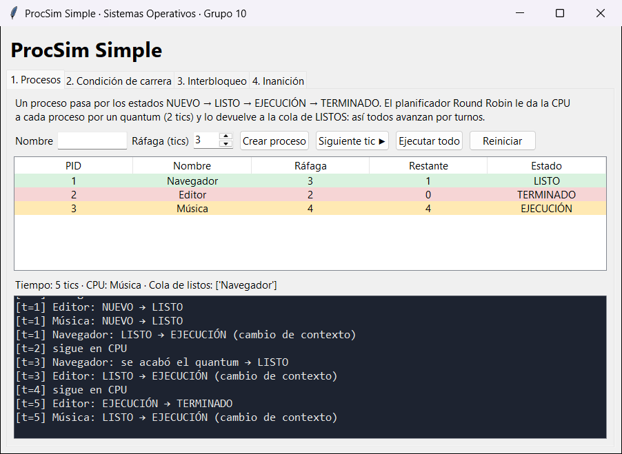
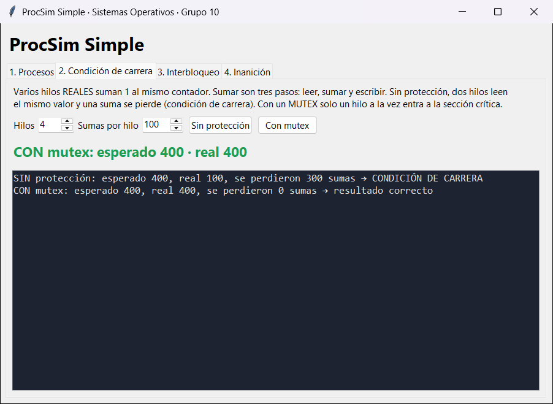
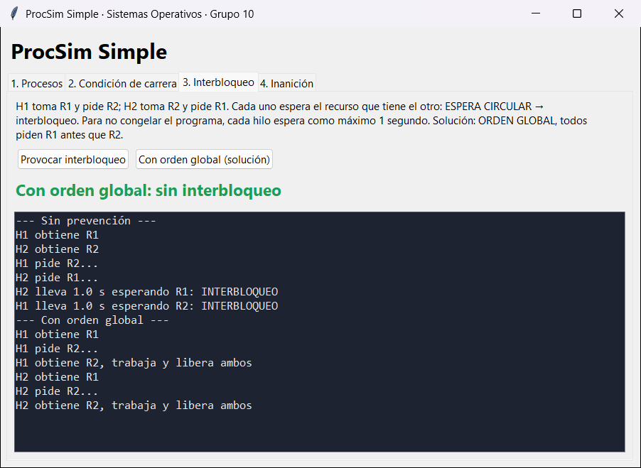
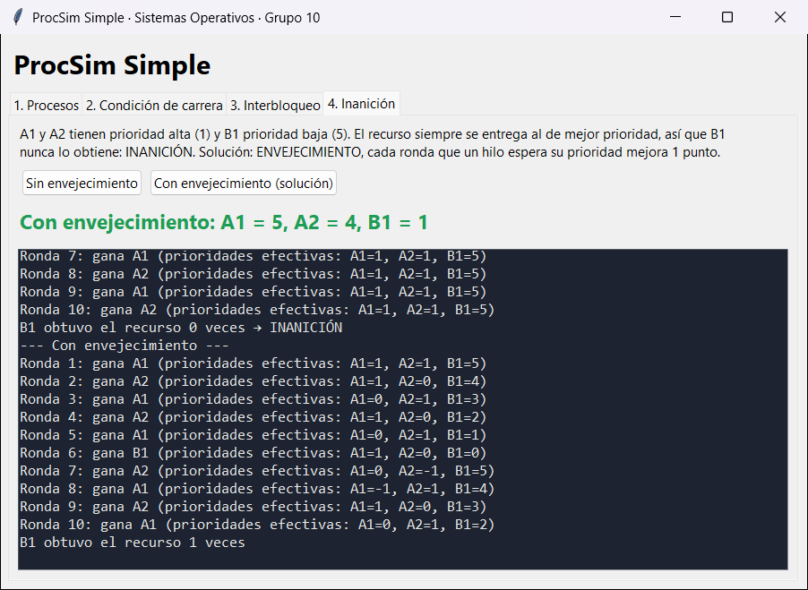

# ProcSim Simple

Versión simplificada de ProcSim Local: **4 demostraciones** de Sistemas Operativos en una ventana con pestañas.
Son solo 3 archivos de Python, sin base de datos y sin instalar nada.

| Archivo | Qué contiene |
|---|---|
| `logica.py` | La lógica de las 4 demostraciones (sin interfaz). |
| `app.py` | La ventana (Tkinter) con una pestaña por demostración. |
| `test_simple.py` | 7 pruebas automáticas. |

## Cómo ejecutarlo

```bash
python version_simple/app.py                              # abre la ventana
python -m unittest version_simple/test_simple.py -v       # corre las pruebas
```

Requiere Python 3.12 para Windows (Tkinter viene incluido).

## Las 4 demostraciones

### 1. Procesos y planificación Round Robin
Cada proceso pasa por **NUEVO → LISTO → EJECUCIÓN → TERMINADO**. El planificador le da la CPU a cada proceso por un **quantum de 2 tics**; si no terminó, vuelve al final de la cola de LISTOS. Con **Siguiente tic** se avanza paso a paso y se ven los cambios de contexto.

**Flujo de cada tic:** admitir los NUEVOS → el proceso en CPU usa 1 tic → si terminó pasa a TERMINADO; si se le acabó el quantum vuelve a LISTO → si la CPU está libre entra el primero de la cola.



### 2. Condición de carrera y mutex
Varios **hilos reales** suman 1 al mismo contador. Sumar son tres pasos (leer, sumar, escribir): sin protección, dos hilos leen el mismo valor y una suma se pierde. Con un **mutex** (`threading.Lock`) solo un hilo a la vez entra a la sección crítica y el resultado es exacto.

**Flujo de cada hilo:** (mutex.acquire) → leer contador → pausa breve → escribir contador + 1 → (mutex.release) → repetir.



### 3. Interbloqueo
H1 toma R1 y pide R2; H2 toma R2 y pide R1: cada uno espera lo que tiene el otro (**espera circular**). Para no congelar el programa, cada hilo espera máximo 1 s y lo reporta como interbloqueo. **Solución:** orden global, los dos piden R1 antes que R2.



### 4. Inanición
A1 y A2 tienen prioridad alta (1) y B1 baja (5). En cada ronda el recurso va al de mejor prioridad, así que B1 **nunca** lo obtiene. **Solución:** envejecimiento, cada ronda que un hilo espera mejora 1 punto; en la ronda 6 B1 gana.



## Resultados

| Demostración | Sin solución | Con solución |
|---|---|---|
| Carrera (4 hilos × 100) | Contador < 400 (se pierden sumas) | Mutex: 400 exacto |
| Interbloqueo | Detectado | Orden global: sin interbloqueo |
| Inanición (10 rondas) | B1 = 0 accesos | Envejecimiento: B1 ≥ 1 |
